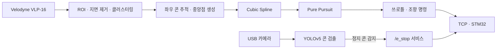

# LiDAR Cone Tracer

**LiDAR 콘 인지 · 중앙 경로 생성 · Pure Pursuit 추종 · STM32 차량 제어 연동**

2025 대학생 창작 모빌리티 경진대회 자작자율차 부문에 TEAM NSSUR(한국공학대학교)로 출전한
자작 자율주행차의 인지·경로·제어 소프트웨어입니다. 대회와 졸업작품 시연에 사용한 2025년 10월 버전입니다.

Velodyne VLP-16 포인트클라우드에서 라바콘을 인지하고, 좌우 콘 사이의 중앙 경로를 생성해
쓰로틀·조향 명령으로 변환한 뒤 TCP로 STM32 모션 컨트롤러에 전달합니다.

## 사용 기술

| 영역 | 기술 |
| --- | --- |
| 개발 환경 | Ubuntu 20.04, ROS Noetic, catkin |
| 언어 | C++, Python |
| LiDAR 처리 | PCL, ROI(PassThrough), RANSAC 지면 제거, Euclidean Clustering, KD-Tree |
| 카메라 | usb_cam, YOLOv5(PyTorch) |
| 경로 생성 | 좌우 콘 KNN 추적, 중앙점 생성, Cubic Spline |
| 경로 추종 | Pure Pursuit, 곡률 기반 적응형 Lookahead, 곡률 기반 쓰로틀 |
| 차량 연동 | ROS 토픽·서비스, TCP/IP 소켓, STM32 |
| 시각화 | RViz |

## 시스템 흐름



## 담당 구현

- **LiDAR 콘 인지:** ROI 필터와 RANSAC 지면 제거, Euclidean Clustering으로 콘 후보를 추출했습니다.
  KD-Tree로 좌우 콘을 각각 추적하면서 진행 방향 각도와 이동 거리 조건을 적용했고,
  한쪽 콘이 일시적으로 누락될 때 직전 좌우 간격으로 위치를 보완하는 옵션(`max_miss`)도 넣었습니다.
- **경로 생성·추종:** 중앙점을 Cubic Spline으로 연결하고, 경로 곡률에 따라 Lookahead를 조정하는
  Pure Pursuit로 조향각을 계산했습니다. 곡률이 클수록 쓰로틀을 낮추도록 구성했습니다.
- **차량 제어 연동:** 주행 명령을 TCP로 STM32에 전달하고, `/e_stop` 서비스로 정지·재개 명령을 보내도록
  구성해 쓰로틀·조향 제어와 E-STOP 동작을 실차에서 확인했습니다.
- **현장 튜닝:** 미션별 launch로 센서 ROI와 주행 파라미터를 나누고, 실제 코스에서 조정하며
  인지부터 차량 구동까지 연결했습니다.

## 프로젝트 결과

- **조향성능 미션 전체 5위 — 팀 성과**
- 기술검차 및 E-STOP 제동검차 통과
- 인지·경로 추종·STM32 연동을 실차에서 구현하고 주행 확인

## 주요 코드

| 패키지 | 내용 |
| --- | --- |
| [`lidar_cone_detector`](src/lidar_cone_detector/) | 포인트클라우드 처리, 좌우 콘 추적, 중앙점 생성, 미션별 launch |
| [`midpoint_tracer`](src/midpoint_tracer/) | Cubic Spline, 적응형 Lookahead, Pure Pursuit, 곡률 기반 쓰로틀 |
| [`ev_controller`](src/ev_controller/) | 주행 명령 TCP 전송, `/e_stop` 서비스 |
| [`pothole_detector/script/cone_detector.py`](src/pothole_detector/script/cone_detector.py) | YOLOv5 카메라 콘 검출 노드 (`/cone_bboxes` 발행) |
| `fs_msgs`, `velodyne`, `usb_cam` | 메시지 정의 및 센서 드라이버(외부 패키지) |

## 빌드

ROS Noetic이 설치된 Ubuntu 20.04에서 워크스페이스 루트 기준으로 빌드합니다.

```bash
source /opt/ros/noetic/setup.bash
rosdep install --from-paths src --ignore-src -r -y
catkin_make
source devel/setup.bash
```

카메라 콘 검출 노드를 쓰는 미션은 YOLOv5와 학습한 가중치가 필요합니다.
기본 경로는 `~/yolov5`, `~/models/best.pt`이며 노드 파라미터 `~yolov5_dir`, `~model_path`로 바꿀 수 있습니다.

```bash
git clone https://github.com/ultralytics/yolov5 ~/yolov5
pip3 install -r ~/yolov5/requirements.txt
```

## 실행

```bash
# LiDAR 기반 주행
roslaunch lidar_cone_detector complete_driving_mission.launch

# 카메라 콘 검출을 함께 쓰는 미션
roslaunch lidar_cone_detector curve_mission.launch
roslaunch lidar_cone_detector acceleration_mission.launch
```

STM32 접속 주소와 포트는 `ev_controller/launch/ev_motor_controller.launch`의
`BLDC_HOST`, `AGNI_HOST`, `PORT`에서 차량 네트워크에 맞게 설정합니다.

## 외부 패키지

| 패키지 | 출처 | 라이선스 |
| --- | --- | --- |
| `fs_msgs` | FSDS 메시지 정의 | Apache-2.0 |
| `velodyne` | [ros-drivers/velodyne](https://github.com/ros-drivers/velodyne) | BSD |
| `usb_cam` | [bosch-ros-pkg/usb_cam](https://github.com/bosch-ros-pkg/usb_cam) | BSD |

외부 패키지의 저작자·라이선스 표기는 원문 그대로 유지했습니다.

직접 작성한 패키지는 MIT 라이선스입니다.
